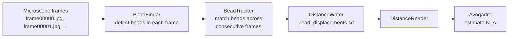
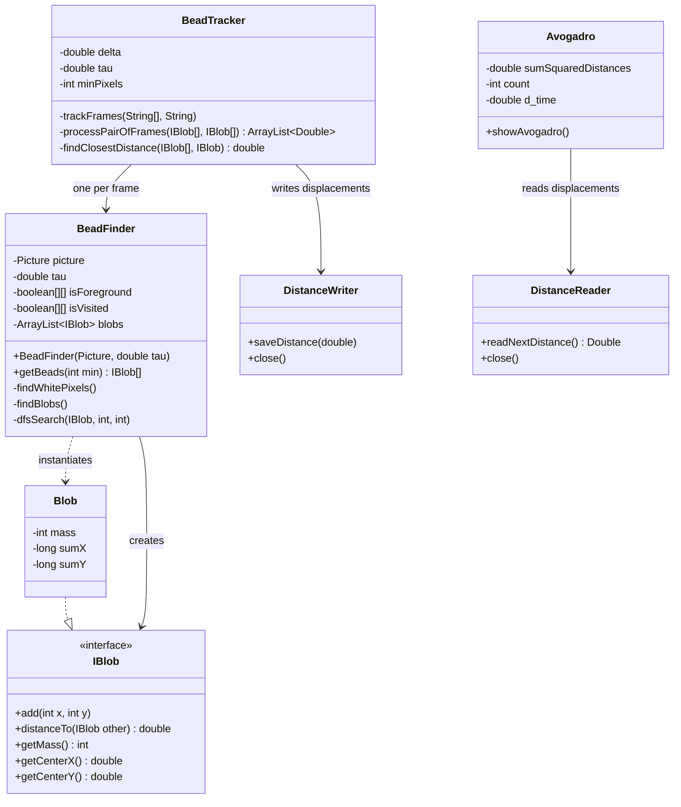
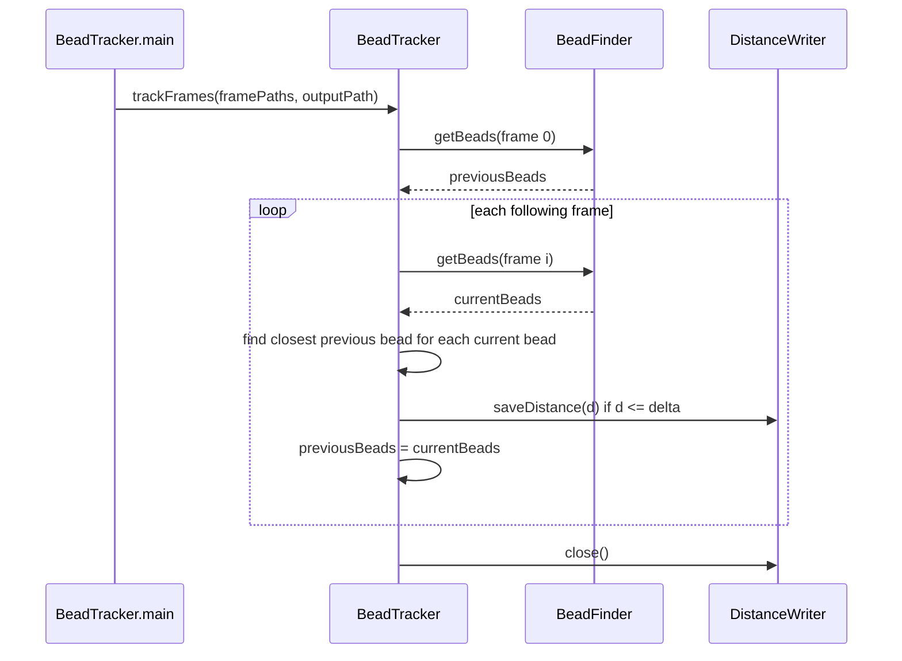
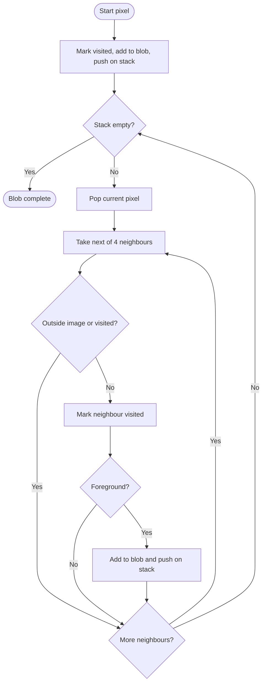

# The Atomic Nature of Matter


> Estimating **Avogadro's number** from the Brownian motion of microscopic beads, using blob detection, frame-to-frame tracking and the Einstein–Stokes relation.

This project re-creates the experiment that Jean Perrin used in the early 1900s to provide experimental evidence for the existence of atoms. Given a sequence of microscope frames showing beads suspended in water, the program detects every bead, measures how far each one moves between consecutive frames, and turns those displacements into an estimate of Boltzmann's constant and Avogadro's number.

---

## Table of Contents

- [Overview](#overview)
- [Features](#features)
- [Scientific Background](#scientific-background)
- [Architecture](#architecture)
- [Algorithms](#algorithms)
- [Getting Started](#getting-started)
- [Usage](#usage)
- [Configuration](#configuration)
- [Data Formats](#data-formats)
- [Project Structure](#project-structure)
- [Complexity](#complexity)
- [Known Limitations](#known-limitations)
- [Roadmap](#roadmap)
- [Authors](#authors)
- [License](#license)

---

## Overview

The program is a three-stage pipeline:



1. **Detection**: `BeadFinder` thresholds a frame by brightness, groups connected bright pixels into blobs, and keeps blobs that are large enough to be beads.
2. **Tracking**: `BeadTracker` matches each bead to its nearest neighbour in the previous frame and records the displacement when it is plausible.
3. **Estimation**: `Avogadro` reads the displacements, computes the diffusion coefficient, Boltzmann's constant and finally Avogadro's number.

## Features

- Iterative (stack-based) flood fill: no recursion, so large blobs can never cause a `StackOverflowError`.
- Constant-time center-of-mass computation per blob, using running coordinate sums.
- Noise filtering through a minimum bead size.
- Outlier rejection through a maximum displacement threshold (`delta`).
- Input validation with clear exception messages for invalid parameters.
- Interface-based design (`IBlob`), so the blob implementation can be swapped without touching the detector.
- Locale-safe number formatting (`Locale.US`), so output files are portable across systems.

## Scientific Background

Small particles suspended in a fluid move randomly because they are constantly hit by fluid molecules (Brownian motion). Einstein showed that the mean squared displacement of a particle is proportional to time, with the proportionality given by the diffusion coefficient `D`. Combining this with Stokes' law for the drag on a sphere links `D` to Boltzmann's constant `k`:

```
D = k·T / (6π·η·ρ)        ->        k = 6π·η·ρ·D / T
```

Since the gas constant is `R = N_A · k`, measuring `k` gives Avogadro's number:

```
N_A = R / k
```

The code performs these steps as follows:

| Step | Formula | Meaning |
|------|---------|---------|
| Unit conversion | `r = pixels · 0.175 µm` | Pixel displacement to meters |
| Variance per axis | `σ² = Σ r² / (2N)` | N displacements, 2 axes |
| Diffusion coefficient | `D = σ² / (2·Δt)` | Δt = time between frames |
| Boltzmann constant | `k = 6π·η·ρ·D / T` | Stokes–Einstein relation |
| Avogadro's number | `N_A = R / k` | R = 8.31446 J/(mol·K) |

**Physical constants used in the code**

| Symbol | Value | Description |
|--------|-------|-------------|
| `Δt` | 0.5 s | Time between consecutive frames |
| `η` | 9.135 × 10⁻⁴ Pa·s | Viscosity of the fluid |
| `ρ` | 0.5 × 10⁻⁶ m | Bead radius |
| `T` | 297 K | Absolute temperature |
| `R` | 8.31446 J/(mol·K) | Gas constant |
| scale | 0.175 µm / pixel | Microscope calibration |

The accepted value of Avogadro's number is about `6.022 × 10²³ mol⁻¹`, which is a useful reference when judging the output.

## Architecture



### Tracking sequence



## Algorithms

### Bead detection

1. Convert each pixel to luminance: `0.299·R + 0.587·G + 0.114·B`.
2. Mark the pixel as foreground if its luminance is `>= tau`.
3. Scan the image. Every unvisited foreground pixel starts a new blob.
4. Grow the blob with a depth-first search over the 4 neighbours (up, right, down, left).
5. Return only blobs with at least `min` pixels.



Every pixel is marked as visited exactly once, so no pixel is processed twice.

### Bead tracking

For each pair of consecutive frames, every bead in the current frame is compared with all beads in the previous frame. The smallest center-to-center distance is kept, and it is recorded only if it is at most `delta` pixels. This discards matches that are far too large to be real motion, such as beads entering or leaving the field of view.

## Getting Started

### Prerequisites

- JDK 10 or newer (the code uses `var`)
- A `Picture` class for reading images (for example the one from the Princeton `introcs` / `algs4` standard library), available on the classpath
- A set of frames named `frame00000.jpg`, `frame00001.jpg`, ...

### Build

```bash
javac *.java
```

## Usage

### 1. Detect beads in one image

```bash
java BeadFinder <min> <tau> <imagePath>

# example
java BeadFinder 25 180.0 frame00001.jpg
```

Without arguments, the built-in defaults from `main` are used. The program prints the number of blobs, the number of valid beads and each bead as `mass (centerX, centerY)`.

### 2. Track beads across a run

```bash
java BeadTracker
```

You are prompted for `delta`, the maximum displacement in pixels between two frames for a match to count. The tracker processes `frameCount` frames and writes one displacement per line.

### 3. Estimate Avogadro's number

```bash
java Avogadro
```

The program reads `bead_displacements.txt` and prints the variance, `D`, `K` and the final `Avogadro` estimate.

## Configuration

| Parameter | Where | Meaning | Default |
|-----------|-------|---------|---------|
| `tau` | `BeadFinder`, `BeadTracker` | Brightness threshold, 0–255 | `180.0` |
| `min` / `minPixels` | `BeadFinder`, `BeadTracker` | Minimum blob size for a bead | `25` |
| `delta` | `BeadTracker` | Maximum displacement between frames (pixels) | entered at runtime |
| `frameCount` | `BeadTracker.main` | Number of frames to process | `200` |
| `runDirectory` | `BeadTracker.main` | Folder containing the frames | local path, change it |
| `d_time` | `Avogadro` | Time between frames in seconds | `0.5` |

Validation rules enforced by `BeadTracker`:

- `delta >= 0`
- `0 <= tau <= 255`
- `minPixels > 0`
- at least two frames and a non-null output path

## Data Formats

**Input**: JPEG frames named `frameNNNNN.jpg` (five-digit, zero-padded index).

**Intermediate file**: `bead_displacements.txt`, one displacement in pixels per line, four decimal places, `.` as the decimal separator:

```
1.2345
0.8721
2.0417
```

**Detector output** (`BeadFinder`):

```
Image: frame00001.jpg
Tau: 180.0
Min pixels: 25

--- Test Results ---
Total Blobs: 15 -> PASS
Valid Beads: 13 -> PASS

--- Detected Beads ---
<mass> (<centerX>, <centerY>)
...
```

The expected counts (15 blobs, 13 beads) apply to the sample frame with `min = 25` and `tau = 180`.

## Project Structure

```
.
├── IBlob.java            Blob interface
├── Blob.java             Blob implementation (mass and center of mass)
├── BeadFinder.java       Blob and bead detection in a single image
├── BeadTracker.java      Frame-to-frame matching and displacement recording
├── DistanceWriter.java   Writes displacements to bead_displacements.txt
├── DistanceReader.java   Reads displacements from bead_displacements.txt
└── Avogadro.java         Computes D, k and Avogadro's number
```

## Complexity

Let `W × H` be the image size, `F` the number of frames and `B` the number of beads per frame.

| Operation | Time | Extra space |
|-----------|------|-------------|
| Thresholding one frame | O(W·H) | O(W·H) |
| Blob detection (DFS) | O(W·H) | O(W·H) |
| Center of mass of a blob | O(1) | O(1) |
| Matching one frame pair | O(B²) | O(B) |
| Whole run | O(F · (W·H + B²)) | O(W·H + B) |

## Known Limitations

- **Output path is ignored.** `BeadTracker.trackFrames` validates `outputFilePath`, but `DistanceWriter` always writes to `bead_displacements.txt`. The completion message therefore names a file that may not exist.
- **Hard-coded local paths** in the `main` methods must be edited on other machines.
- **Greedy nearest-neighbour matching.** Two beads in one frame may be matched to the same bead in the previous frame, and no check prevents it.
- **Fixed physical constants** (`η`, `ρ`, `T`, scale, `Δt`) are embedded in `Avogadro`; a different experiment requires editing the source.
- **4-connectivity only.** Diagonally touching pixels are not merged into one blob.

## Roadmap

- [ ] Pass the output file path through `DistanceWriter` and `DistanceReader`
- [ ] Move physical constants into a configuration file or constructor arguments
- [ ] One-to-one bead matching between frames
- [ ] Unit tests for `Blob`, `BeadFinder` and `Avogadro`
- [ ] Command-line arguments for `BeadTracker` and `Avogadro`

## Authors

TODO: add author names, course and university.

## License

TODO: choose a license, or state that this project is for educational use only.
